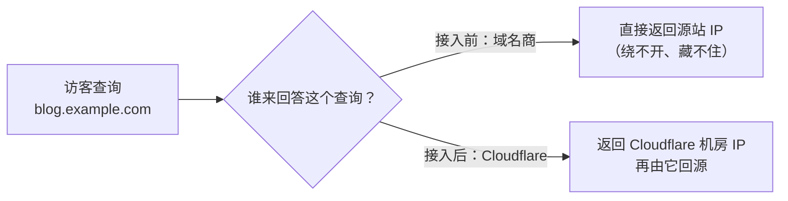
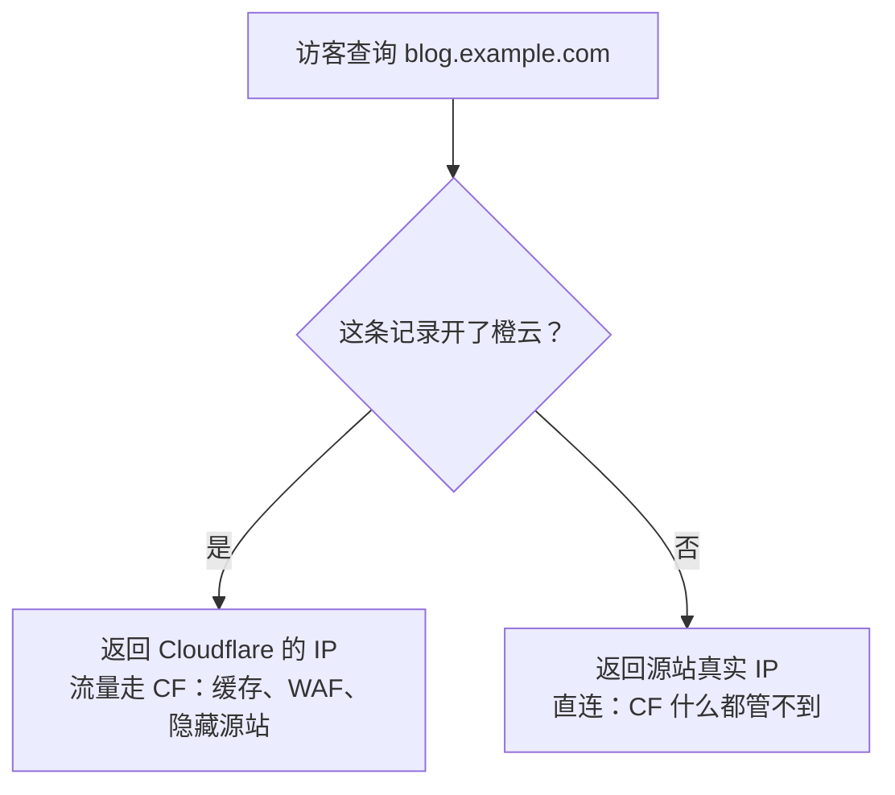
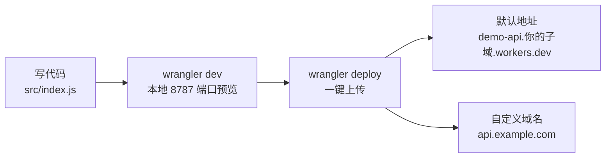
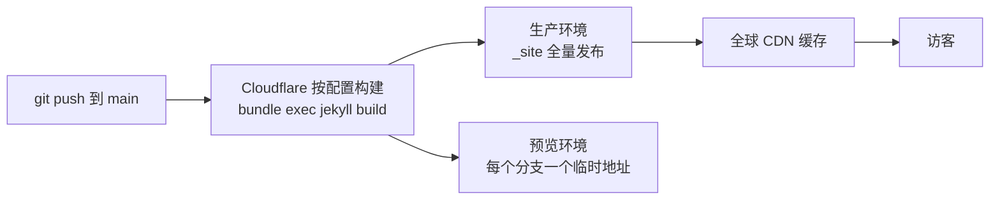
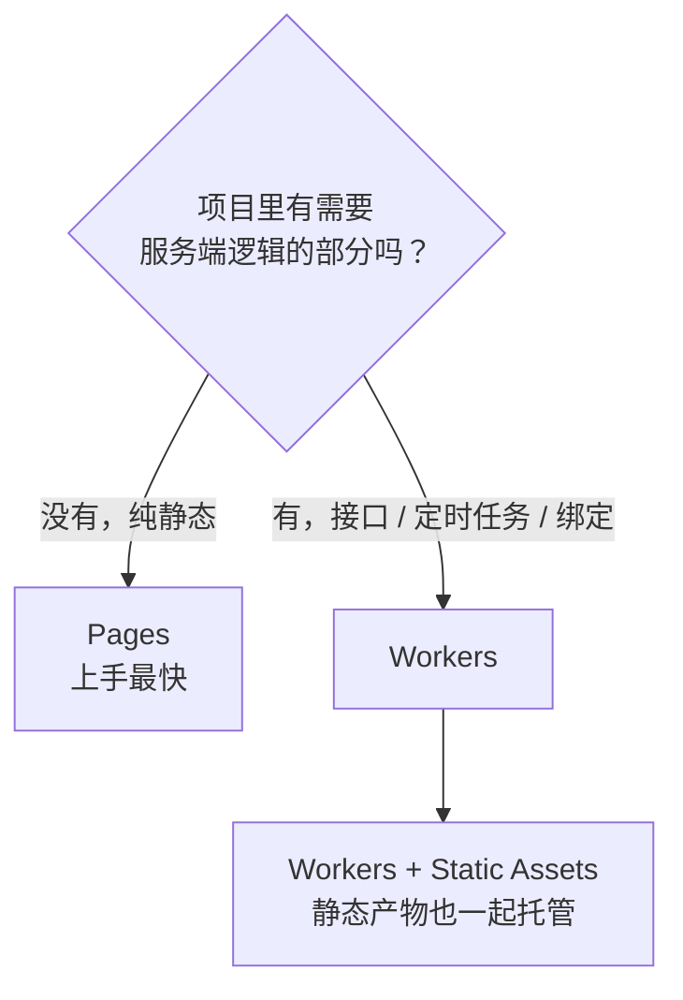

Cloudflare 一句话概括：**它站在你的网站门口，替你把「加速、防护、证书」都办了**。
本文按新手容易上手的顺序讲：先看懂它站在哪 → 把域名交过去 → 决定哪些流量走它 → 用它跑代码和放静态站 → 最后把证书配好。
文中数字都按 2026 年 11 月的官方文档核对过，动手前建议再扫一眼对应页面。

Cloudflare 的官方入口就这几个，后面用到时不再重复：

| 用途 | 官方地址 |
| --- | --- |
| 官网、套餐对比 | [www.cloudflare.com](https://www.cloudflare.com/){:target="_blank" rel="noopener"} |
| 控制台（注册、DNS、Workers、Pages 都在这里） | [dash.cloudflare.com](https://dash.cloudflare.com/){:target="_blank" rel="noopener"} |
| 开发文档（本文数字的来源） | [developers.cloudflare.com](https://developers.cloudflare.com/){:target="_blank" rel="noopener"} |
| 运行状态（排障先看一眼是不是官方故障） | [www.cloudflarestatus.com](https://www.cloudflarestatus.com/){:target="_blank" rel="noopener"} |

## 0. 先建立直觉：Cloudflare 站在哪

假设你在家里的一台旧电脑上跑了个博客，地址是 `http://1.2.3.4:8080`。
问题很明显：别人得记住一串数字、你的公网 IP 暴露在外、家里断网就全没了、离得远的人打开很慢。

接入 Cloudflare 之后，访客访问的是 `blog.example.com`，请求会先落到离他最近的 Cloudflare 机房，再由 Cloudflare 转给你的电脑：


图里几个词先记住，后面会反复出现：

| 词 | 白话解释 |
| --- | --- |
| 源站 | 真正存着你网站内容的那台机器 |
| 回源 | Cloudflare 自己跑去源站取内容，取完可以缓存下来 |
| 边缘节点 | Cloudflare 部署在各地的机房，用户就近接入 |
| 橙云（Proxied） | 这条 DNS 记录走 Cloudflare，即上图那条链路 |
| 灰云（DNS only） | 只做域名解析，直接把源站 IP 告诉访客，Cloudflare 不管流量 |
| TTL | DNS 结果在别人电脑上缓存多久 |

> 再打个比方：源站是你家厨房，Cloudflare 是小区门口的快递驿站。
> 橙云 = 所有快递都走驿站（快、能代收、能拦可疑包裹）；灰云 = 你自己下楼取（驿站根本不知道有这单）。
{: .prompt-tip }

## 1. 免费版能给你什么

很多人以为「免费 = 试用」，Cloudflare 的免费套餐其实是长期可用的，只是额度有限：

| 能力 | 免费额度 | 对个人项目的意义 |
| --- | --- | --- |
| DNS 托管 + CDN | 不限带宽、不限请求数 | 静态站怎么刷流量都不花钱 |
| Universal SSL 证书 | 自动签发、自动续期 | 不用再折腾 certbot |
| Workers | 10 万请求/天，CPU 每次 10 ms | 够跑个人 API、小工具、演示 |
| Pages | 每月 500 次构建，单站 2 万个文件 | 博客、文档站足够 |
| Workers KV | 1 GB 存储，10 万读/天、1 千写/天 | 存配置、缓存、短链接 |

什么时候**别**用它：要跑重计算（免费 Workers 每次只有 10 ms CPU）、要长连接常驻服务（不如直接上 Nginx）、以及境内访问且涉及备案合规的业务（先确认政策再动手）。

## 2. 第一步：把域名交给 Cloudflare

这一步的本质是**换掉域名的「总机」**。域名的 NS（Name Server）记录决定了「谁来回答这个域名指向哪」，把它改成 Cloudflare 之后，解析权就到了 Cloudflare 手里：



具体操作（5 分钟能做完）：

1. 到 [dash.cloudflare.com](https://dash.cloudflare.com/){:target="_blank" rel="noopener"} 注册账号，点 **Add a domain**，填根域 `example.com`（不是 `blog.example.com`）。
2. 选套餐，先用 **Free**。
3. Cloudflare 会自动扫描你现有的解析记录，扫漏的手工补上（尤其是 MX 邮箱记录，漏了会收不到邮件）。
4. 去域名注册商后台，把 NS 改成 Cloudflare 给你的两个地址，形如 `xxx.ns.cloudflare.com`。
5. 回来等状态变成 **Active**，一般几分钟到几小时，官方说法最长 24 小时。

这套叫 **Full setup（全量接入）**，免费版只能走这条。
另一种 **CNAME / Partial setup（部分接入）** 只把某个子域 CNAME 过来，适合「域名解析还留在别的服务商」的场景，需要 Business 以上套餐或通过合作伙伴。

> 域名如果在 Cloudflare Registrar 注册，本身就用 Cloudflare 做 DNS，第 4 步可以跳过。
{: .prompt-tip }

## 3. 第二步：决定每条记录「过不过 Cloudflare」

域名交出去之后，Dashboard 的 DNS 页面里每条记录右侧都有一个云朵图标，这就是总开关：



| | 橙云 Proxied | 灰云 DNS only |
| --- | --- | --- |
| 访客拿到的 IP | Cloudflare 的 | 你源站的真实 IP |
| 缓存 / WAF / DDoS 防护 | 生效 | 全不生效 |
| 源站 IP 是否暴露 | 隐藏 | 暴露 |
| TTL | 固定 300 秒，改不了 | 自己设 |

三条经验，能省掉大部分踩坑：

- **只有 A、AAAA、CNAME 能开橙云**，MX、TXT 永远是灰云，别找了。
- **同一个名字下有多条 A 记录时，只要一条开了橙云，整个名字都按代理处理**，混合配置不会按你想的分流。
- **做域名归属验证用的 CNAME/TXT 不要开橙云**，开了验证必然失败。

### 开了橙云之后的两个副作用

**一、源站日志里看不到访客 IP。** 你看到的是 Cloudflare 机房的地址，真实访客 IP 在请求头 `CF-Connecting-IP` 里。Nginx 想恢复真实 IP 要加：

```nginx
set_real_ip_from 173.245.48.0/20;   # 按官方 IP 段补全
set_real_ip_from 103.21.244.0/22;
real_ip_header CF-Connecting-IP;
```

**二、源站还是可能被绕过去直连。** 知道 IP 的人可以直接打你的机器，这时候缓存、WAF、限速全都不起作用。三个常见补法：

1. 源站防火墙只放行 Cloudflare 的 IP 段（写个脚本定期同步官方列表）。
2. 用 **Cloudflare Tunnel**，源站不开放任何公网端口。
3. 开 **Authenticated Origin Pulls**，回源必须带 Cloudflare 的客户端证书。

## 4. Workers：不用买服务器，上传一个函数就是一个接口

Workers 跑在 V8 引擎里，不是容器，所以没有「冷启动」等待；你写的一段 JavaScript 会被部署到全球机房，谁访问都跑在离他最近的那台机器上。



### 五分钟跑通第一个 Worker

```sh
npm create cloudflare@latest -- demo-api   # 模板选 Worker only + JavaScript
cd demo-api
npx wrangler dev      # 本地 http://localhost:8787
npx wrangler deploy   # 部署，输出一个 *.workers.dev 地址
npx wrangler tail     # 线上实时日志
```

生成的目录很简单：

```text
demo-api/
├── src/index.js          # 入口，就一个函数
├── wrangler.jsonc        # 配置：名字、入口、绑定、域名
└── package.json
```

默认代码长这样，逐行看就懂了：

```js
export default {
  // 每个 HTTP 请求进来都会调用这个函数
  async fetch(request, env) {
    const url = new URL(request.url);        // 拿到请求的路径、参数

    if (url.pathname === '/api/health') {    // 自己写路由：只有这个路径返回 JSON
      return Response.json({ ok: true, at: Date.now() });
    }

    return new Response('Not Found', { status: 404 }); // 其余一律 404
  },
};
```

`env` 是「环境变量和各种绑定资源的入口」，`request` 就是浏览器发来的请求，函数返回 `Response` 就完事——和浏览器里的 `fetch` 是同一套心智模型。

### 想存点数据？加个 KV 绑定

在 `wrangler.jsonc` 里声明绑定，代码里就能通过 `env.` 拿到：

```jsonc
{
  "$schema": "./node_modules/wrangler/config-schema.json",
  "name": "demo-api",
  "main": "src/index.js",
  "compatibility_date": "2026-11-19",
  "kv_namespaces": [{ "binding": "CACHE", "id": "<KV_NAMESPACE_ID>" }],
  "routes": [{ "pattern": "api.example.com", "custom_domain": true }]
}
```

```js
export default {
  async fetch(request, env) {
    const hit = await env.CACHE.get('greeting');
    if (hit) return new Response(hit);

    await env.CACHE.put('greeting', 'hello from kv');
    return new Response('cache miss, written');
  },
};
```

`routes` 里写 `custom_domain: true`，Cloudflare 会自动建解析、自动签证书，前提是域名已经在这个账号下激活。

> KV 是最终一致的：写完之后别的机房可能要几十秒才看得到，而且写同一个 key 免费版限制 1 次/秒。
> **不要拿它当计数器或库存**，那类场景用 D1 或 Durable Objects。
{: .prompt-warning }

### 容易撞上的限额

| 项目 | 免费版 |
| --- | --- |
| 请求数 | 10 万/天（UTC 零点重置，**账号级**，跟部署几个 Worker 无关） |
| CPU 时间 | 每次 10 ms，超了报 `Error 1102` |
| 内存 | 128 MB |
| 单次请求子请求 | 50 个 |
| 环境变量 | 64 个/Worker |

请求超了报 `Error 1027`。平均一个 Worker 每次只用约 2.2 ms CPU，真正容易超时的是图像处理、大 JSON 解析这类活。

Workers 最常用的场景：轻量 API、鉴权网关、A/B 分流、URL 重写、定时任务（Cron Triggers，免费 5 个）、给静态站加一层后端。

## 5. Pages：把静态站扔上去，剩下的交给它

Pages 解决的是另一件事：**你只管写 Markdown / 前端，构建和全球分发它来干。** 本站这种 Jekyll 博客就是典型用法。



### 走 Git 集成（推荐）

Dashboard 里 `Workers & Pages → Create application → Pages → Connect to Git`，选完仓库填三个框：

| 配置项 | 本站（Jekyll）该填什么 |
| --- | --- |
| Production branch | `main` |
| Build command | `bundle exec jekyll build` |
| Build output directory | `_site` |
| 环境变量 | `RUBY_VERSION = 3.1.3`（要和 Gemfile 要求一致） |

之后每次 push 自动构建，非主分支会生成**预览部署**，PR 里能直接看效果——相当于把「本地起服务看一眼」搬到云端。

> Jekyll 站搬过来记得把 `_config.yml` 的 `baseurl` 改回空字符串、`url` 换成自己的域名。
> 否则资源还带着 `/myblog` 前缀，页面能打开但样式全丢。
{: .prompt-warning }

### 或者直接上传构建产物

不想连 Git，本地构建完推上去也行：

```sh
bundle exec jekyll build
npx wrangler pages deploy _site --project-name=myblog
```

注意：**Git 集成项目和 Direct Upload 项目不能互相切换**，一开始就想清楚。

### 想在 Pages 上加接口？用 Functions

项目根目录建 `functions/`，一个文件就是一个路由：

```text
functions/
├── api/
│   ├── hello.js      → /api/hello
│   └── [id].js       → /api/:id
└── _middleware.js    → 全站中间件
```

```js
// functions/api/hello.js
export async function onRequestGet({ request, env }) {
  return Response.json({ ok: true, ua: request.headers.get('user-agent') });
}
```

函数调用**计入 Workers 的额度**，所以 Pages 免费版实际是「静态无限 + 每天 10 万次函数调用」，再加上 `_headers`（配响应头）和 `_redirects`（配跳转，最多 2,100 条）两个纯文本文件就能覆盖大部分需求。

限额记住几个数：单站 2 万个文件、单文件 25 MiB、构建超时 20 分钟、免费版每月 500 次构建且同时只跑 1 个。

## 6. Workers 还是 Pages？



| | Pages | Workers（+ Static Assets） |
| --- | --- | --- |
| 定位 | 静态站为主，函数是附加 | 应用为主，静态资源是其中一部分 |
| 构建 | 平台托管构建（Git 集成） | 本地 / CI 构建后 `wrangler deploy` |
| 额度 | 静态不限，函数算 Workers 额度 | 全部算 Workers 额度 |
| 预览 | 每个分支自动预览 | 自己用 Versions / 多个 Worker 组织 |
| 现状 | 可用，但不再加新特性 | 官方推荐的新项目路径 |

一句话结论：**纯博客、文档站用 Pages 最省事；接口和页面混在一起的项目直接 Workers。**

## 7. 证书：链路有两条，别只配一条

新手最容易崩的地方在这。HTTPS 其实是两段，各自需要一张证书：


第 ① 段永远归 Cloudflare 管，你不用操心；第 ② 段取决于你选的加密模式和源站配置。

### ① 边缘证书：Universal SSL

域名激活后自动签发，免费、DV（只验证域名所有权）、**有效期 90 天**，到期前 30 天开始自动续期，全程不用管。

覆盖范围是根域 + **一级**子域：

- `example.com` ✅
- `www.example.com` ✅
- `a.b.example.com` ❌ 二级子域不在覆盖内

更深层子域要靠 **Total TLS**（需付费的 Advanced Certificate Manager）或单独签一张 **Advanced Certificate**。

证书一直 `Pending` 就按这三点查：域名是否 Active、源站 80 端口是否可达（HTTP 验证要用）、`CAA` 记录里有没有放行 Cloudflare 合作的 CA（Let's Encrypt / Google Trust Services / SSL.com）。

### ② 源站证书和加密模式

| 模式 | 浏览器 → CF | CF → 源站 | 什么时候用 |
| --- | --- | --- | --- |
| Off | 无 TLS | HTTP | 别用 |
| Flexible | HTTPS | HTTP 明文 | 源站暂时装不上证书的临时方案 |
| Full | HTTPS | HTTPS，不校验证书 | 源站用自签证书 |
| Full (strict) | HTTPS | HTTPS，校验证书有效性 | **推荐默认选这个** |
| Strict (SSL-Only Origin Pull) | HTTPS | 只接受带客户端证书的回源 | 高安全要求 |

源站证书两种选法：

| | Let's Encrypt | Cloudflare Origin CA |
| --- | --- | --- |
| 谁信任它 | 所有浏览器 | **只有 Cloudflare 信任** |
| 有效期 | 90 天，必须自动续 | 可选，最长 15 年 |
| 适用 | 源站可能被直连 | 源站只接收 Cloudflare 流量 |
| 注意 | 续期失败就全线报错 | 暂停 Cloudflare 或改灰云，访客会报证书不受信 |

> 最坑的组合是 `Flexible` + 源站自己强制跳 HTTPS：Cloudflare 用 HTTP 回源，源站 301 到 HTTPS，浏览器又去请求 Cloudflare……无限循环。
> 要么上 `Full (strict)`，要么把源站的强制跳转关掉，改开 Cloudflare 的 **Always Use HTTPS**。
{: .prompt-danger }

### 三个顺手的开关

| 设置 | 建议 |
| --- | --- |
| Always Use HTTPS | 开，统一 301 到 HTTPS |
| Automatic HTTPS Rewrites | 开，自动修正页面里的 `http://` 混链 |
| Minimum TLS Version | TLS 1.2 |
| HSTS | 确认全站 HTTPS 稳定后再开，先给短 `max-age`；开了很难回退 |

## 8. 常见问题速查

| 现象 / 疑问 | 答案 |
| --- | --- |
| 502 / 522 打不开 | 源站不响应，通常是防火墙挡了 Cloudflare IP 段 |
| 525 SSL handshake failed | 源站 443 没开或证书没配好 |
| 526 Invalid SSL certificate | 源站是自签证书，但模式选了 Full (strict) |
| 524 A timeout occurred | 源站处理超过 100 秒，把慢任务改成异步 |
| 重定向次数过多 | Flexible + 源站强制 HTTPS |
| 深层子域证书不匹配 | Universal SSL 只覆盖一级子域 |
| 站点一直 Pending | NS 未生效 / CAA 拦了 CA / 80 端口不通 |
| Error 1027 / 1102 | Workers 当天请求超限 / 单次 CPU 超 10 ms |
| 不用自己的域名能用 Workers 吗 | 能，`*.workers.dev` 自带域名和证书 |
| 缓存更新不及时 | 用 Cache Rules 调 TTL，或发版时按 URL 清理缓存 |

## 9. 本站要用的组合

把这套落到自己的博客上，最小可用配置是：

1. 域名 NS 指向 Cloudflare（Full setup，Free）。
2. Jekyll 站交给 Pages：构建 `bundle exec jekyll build`、输出 `_site`、`RUBY_VERSION=3.1.3`，`baseurl` 改回空。
3. 绑定自定义域（apex + `www`），橙云开启，Universal SSL 自动签发。
4. 加密模式选 `Full (strict)`；如果源站就是 Pages，这一段由 Cloudflare 内部完成，不用管。
5. 开 Always Use HTTPS、TLS 最低 1.2，稳定一段时间后再上 HSTS。

> 文中额度与行为核对时间为 2026-11，Cloudflare 调整比较频繁，动手前建议再扫一眼官方文档对应页面。
{: .prompt-info }

